# OutMed

**B2B medical supply marketplace** for hospitals, clinics, and verified suppliers.

OutMed is a Flutter app that connects **healthcare buyers** (hospitals / facilities) with **medical suppliers**. It is not a consumer store — purchasing is organization-to-organization: catalog, supplier offers, cart, orders, inventory, and in-app messaging.

> Medical supply, simplified.

---

## Project details

| | |
| --- | --- |
| **Type** | B2B marketplace (buyer ↔ supplier) |
| **Domain** | Medical supplies, PPE, surgical, diagnostic kits |
| **Platform** | Flutter (iOS / Android), English + Arabic (RTL) |
| **State / architecture** | BLoC (`flutter_bloc`), `get_it`, `go_router` |
| **Data** | Mock catalog by default; Dio client for the real API; SQLite cache |
| **Roles** | **Buyer** (healthcare facility) and **Supplier** (vendor) |

### Buyer (hospital / facility)

- Browse a shared master catalog and compare supplier offers
- Product detail, quantity, add to cart, checkout
- Order history, tracking, and **Buy again**
- Messages with suppliers

### Supplier (vendor)

- Publish **offers** on master products (price, stock, MOQ, lead time)
- **Edit / delete** own offers from inventory
- Stock updates, low-stock alerts
- Incoming orders and status progression (confirm → prepare → ship → deliver)

---

## Mockup

App screens from the current build (iPhone).

### Buyer flow

<p>
  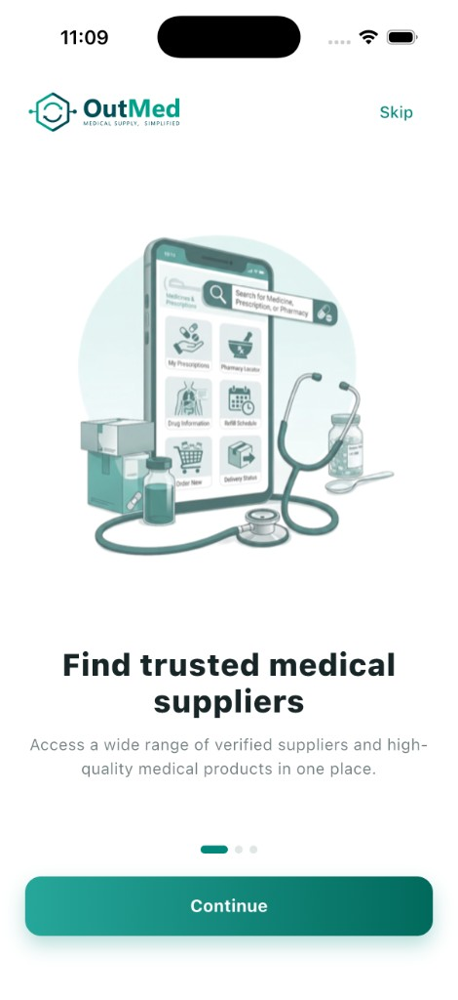
  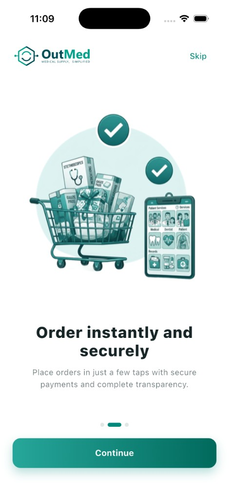
  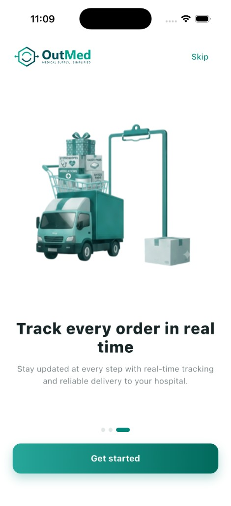
  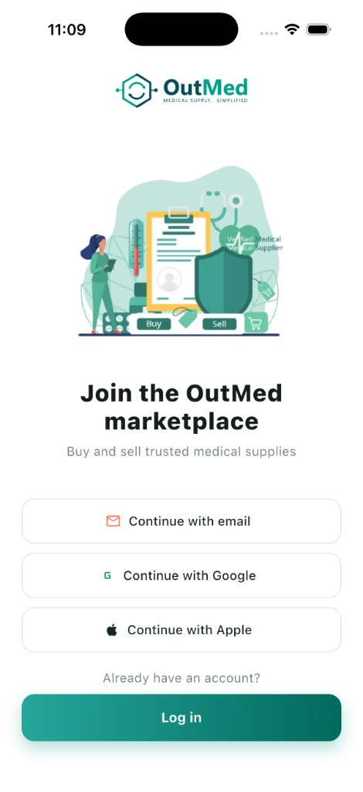
</p>
<p>
  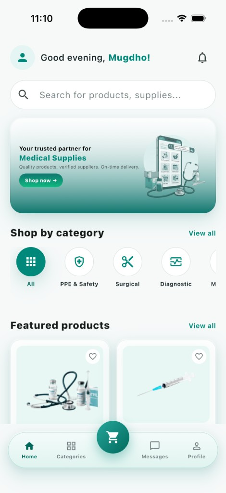
  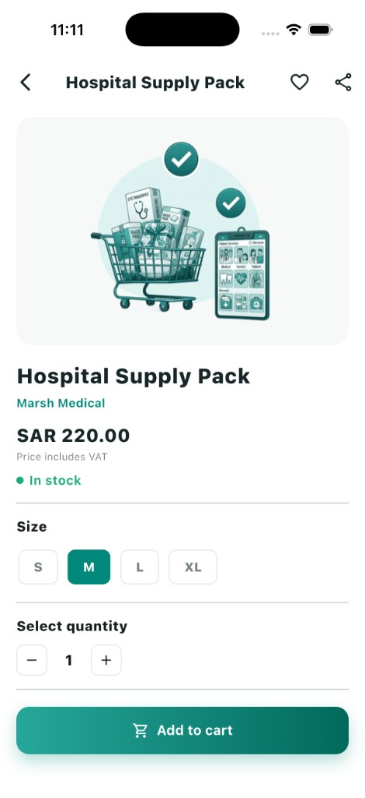
  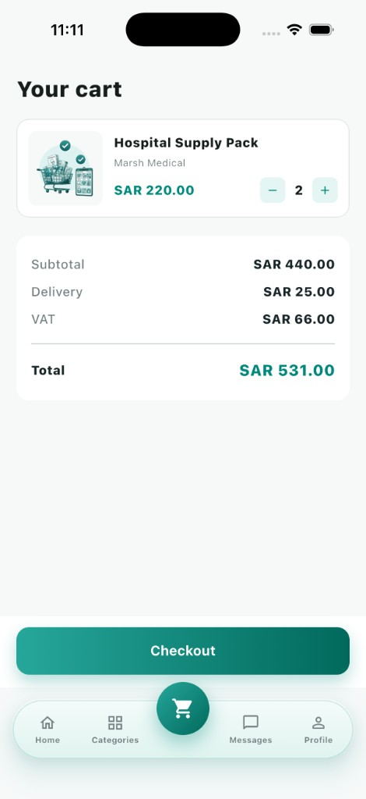
  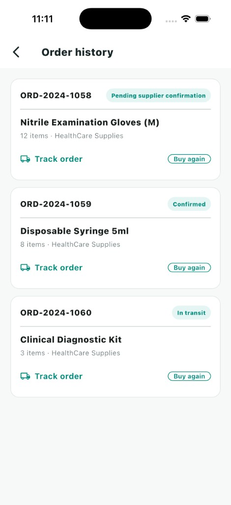
</p>
<p>
  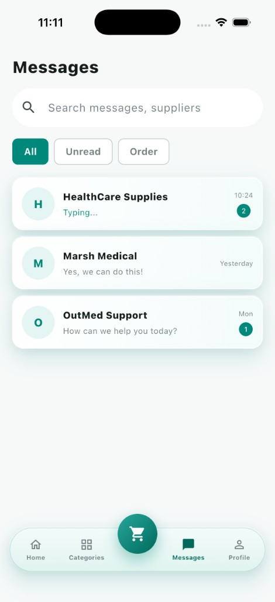
  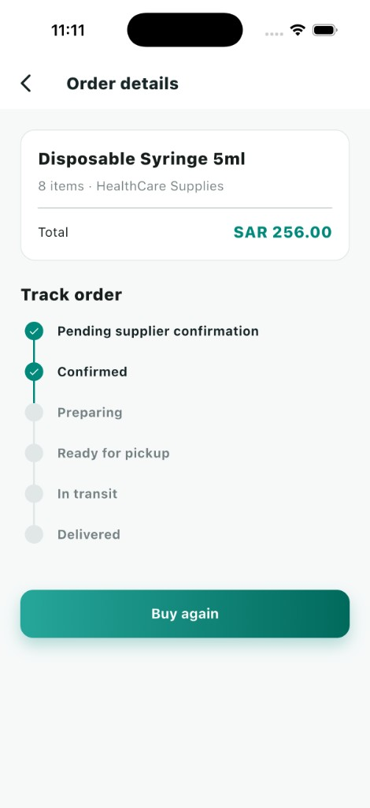
  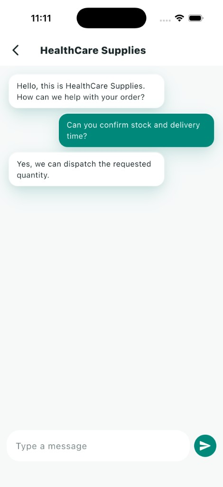
</p>

### Supplier flow

<p>
  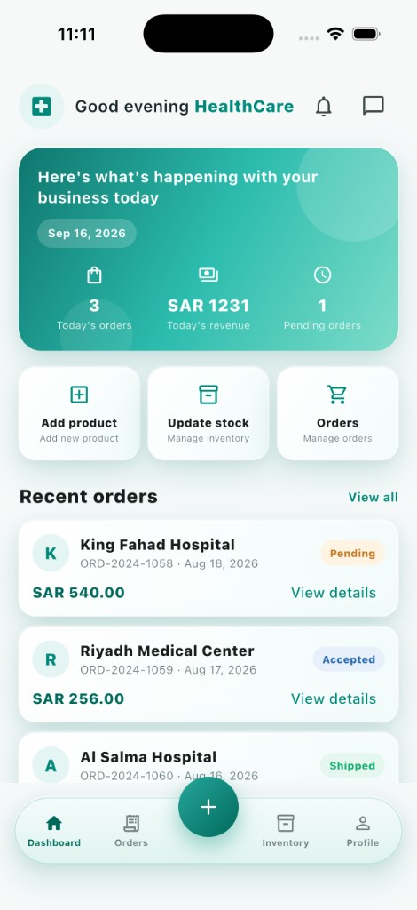
  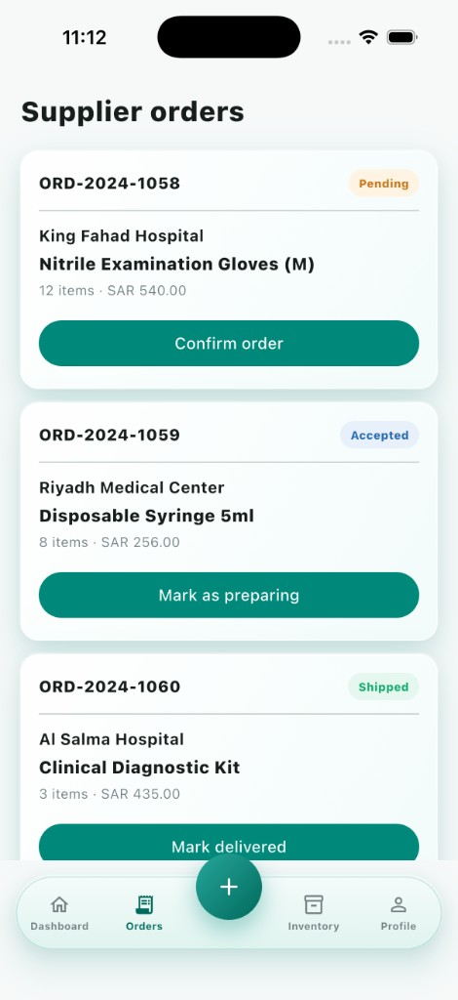
  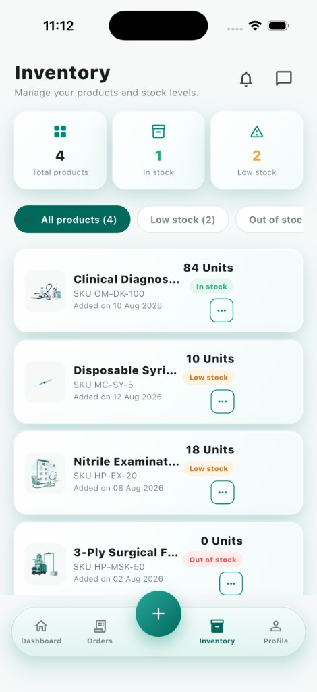
  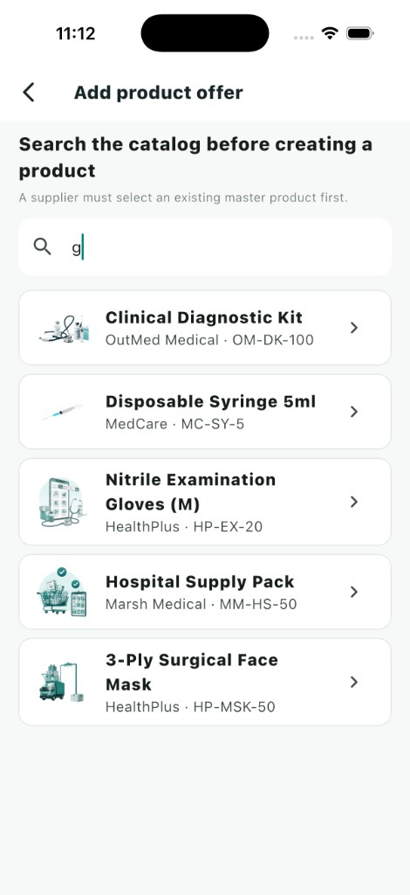
  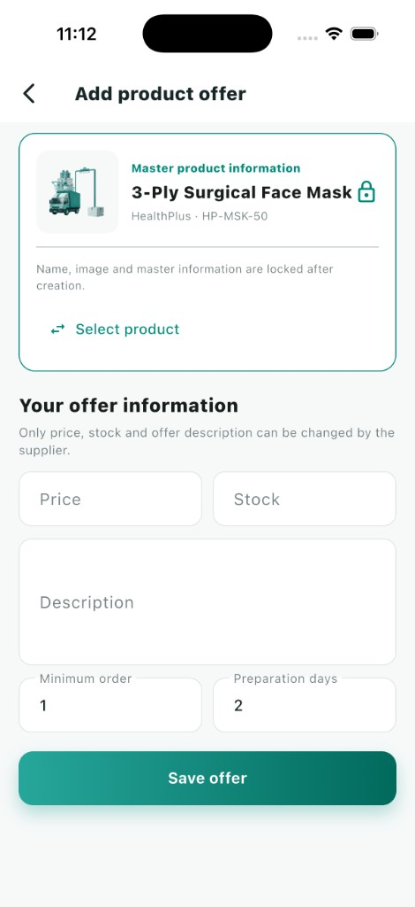
</p>

| Screen | What it shows |
| --- | --- |
| Onboarding | Find suppliers, order securely, track deliveries to the hospital |
| Auth | Join the OutMed **B2B marketplace** (email / Google / Apple) |
| Buyer home | Search, categories, featured products |
| Product / cart | Offer price, VAT, delivery, checkout |
| Order history | Past B2B orders + **Buy again** |
| Messages / chat | Buyer–supplier coordination |
| Supplier dashboard | Today’s orders, revenue, quick actions |
| Orders | Confirm and advance hospital orders |
| Inventory | Own offers; **⋯** menu to update stock, edit, or delete |
| Add offer | Select a master product, then set price / stock |

---

## Run locally

```bash
flutter pub get
flutter run
```

`flutter run` calls the API (`APP_ENV=dev`): login, registration, products, offers, and orders. If the host is down, the catalog stays on the last local copy and login shows an error under the button.

```bash
flutter run --dart-define=APP_ENV=mock
flutter run --dart-define=STRIPE_PUBLISHABLE_KEY=pk_test_replace_me
flutter run --dart-define=API_BASE_URL=https://your-host
```

Docs: `https://<host>/api/docs`.

Firebase stays off until you pass `--dart-define=FIREBASE_ENABLED=true` and add the platform config files. See `docs/release.md` and `docs/adr/0001-bloc-sqlite-dio.md`.

---

## Stack

- Flutter 3 / Dart 3
- `flutter_bloc`, `get_it`, `go_router`, `dio`, `sqflite`
- Stripe payment sheet (publishable key only)
- `flutter_svg`, `image_picker`, `shimmer`
- Feature modules: `auth`, `buyer`, `supplier`, `catalog`, `cart`, `orders`, `messages`, `profile`
- CI: GitHub Actions (`.github/workflows/ci.yml`)
